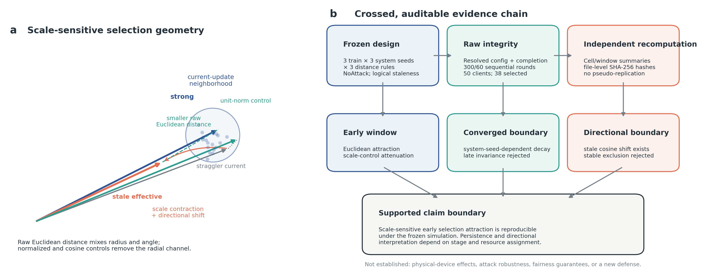
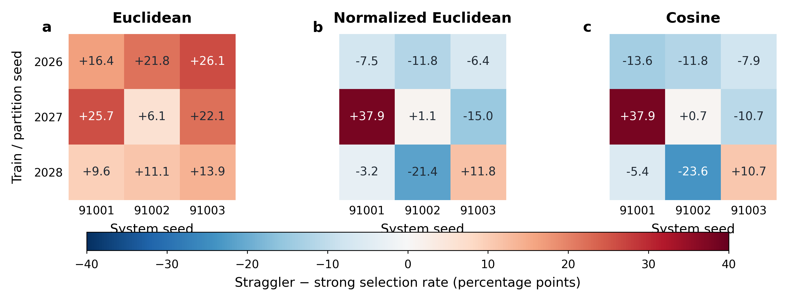
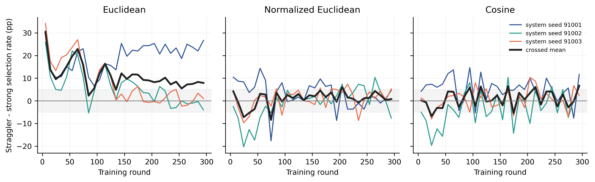
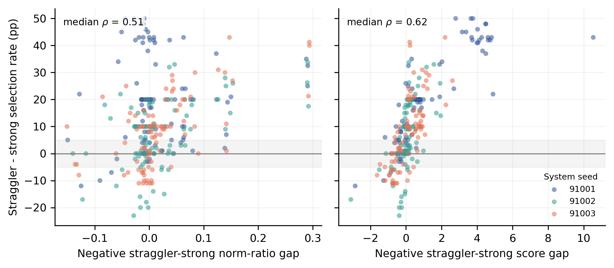
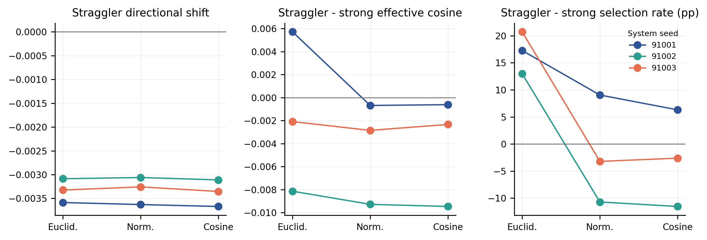
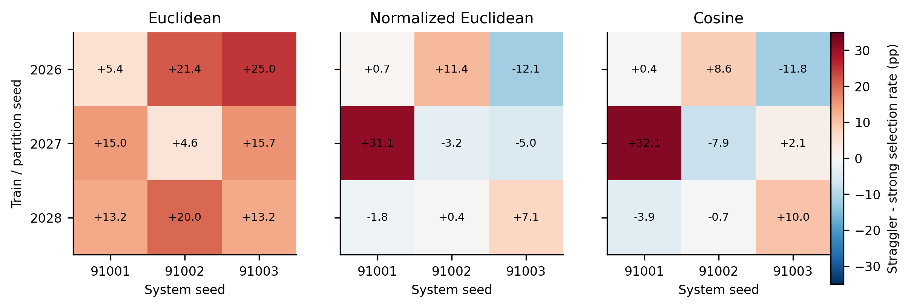
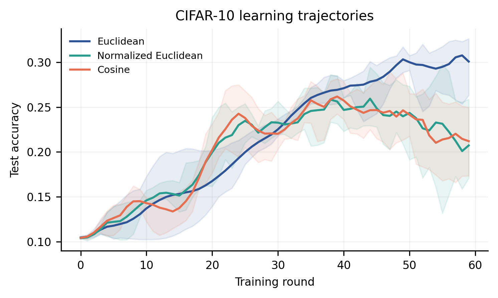

# When Staleness Attracts: Training-Stage- and Assignment-Dependent Selection Geometry of Multi-Krum under Non-IID Federated Learning

**Authors:** [AUTHOR NAMES TO CONFIRM]

**Affiliations:** [AFFILIATIONS TO CONFIRM]

**Corresponding author:** [CORRESPONDING AUTHOR TO CONFIRM]

## Abstract

Selection-based Byzantine-robust aggregation may treat honest updates unequally when statistical and system heterogeneity interact. We instrument Multi-Krum under controlled logical staleness using a frozen crossed design that separates train/partition from resource-assignment seeds and compares Euclidean scoring with normalized-Euclidean and cosine controls. On FashionMNIST/LeNet, Euclidean Multi-Krum favors stale straggler over current strong-client updates in rounds 2--29 for every system-seed margin (12.98--20.71 percentage points). Both scale-removing controls attenuate or reverse this disparity for every assignment, supporting a radial-scale contribution. The effect is not a converged invariant: two assignments reach sustained practical neutrality, while one remains positive. A frozen directional audit finds consistent within-straggler angular drift but no assignment-stable direction-exclusion mechanism. On CIFAR-10/simpleCNN, the frozen transfer grid independently reproduces the early effect and both metric-control contrasts across all three assignments. Exact coverage, configurations, completion markers, and hashes are checked for every formal cell, and summaries are independently recomputed from raw logs. The results motivate reporting selection geometry by training stage and resource assignment rather than treating one averaged trajectory as a general robustness property.

**Keywords:** federated learning; Byzantine-robust aggregation; Multi-Krum; system heterogeneity; non-IID data; logical staleness; reproducibility

## 1. Introduction

Federated learning coordinates model training across clients that retain their local data [@mcmahan2017communication]. Two forms of heterogeneity complicate this setting. Statistical heterogeneity makes honest client updates differ because their local data distributions differ, while system heterogeneity changes when or how updates are produced and received [@li2020fedprox]. These sources are often studied separately: optimization methods address client drift, systems methods address stragglers or stale updates, and Byzantine-robust aggregation rules seek to suppress malicious updates. Their interaction, however, can change which *honest* updates a selection-based robust aggregator retains.

Krum assigns each update a score formed from nearby pairwise distances and selects the smallest-scoring update; Multi-Krum retains several low-score updates before averaging [@blanchard2017machine]. The rule was designed for Byzantine resilience, not selection neutrality across honest resource groups. Under non-IID data, honest updates may occupy a dispersed or structured geometry. Prior work has already established that classical robust aggregation can fail under heterogeneous data [@karimireddy2022bucketing; @liu2023gas], and BOBA directly shows that selection bias can discard honest gradients under label skew [@bao2024boba]. Accordingly, our question is narrower than whether Krum can be biased under non-IID data.

We ask whether controlled logical staleness changes honest-client selection through the geometry used by Multi-Krum. A stale update can differ from its current counterpart both radially and directionally. If staleness contracts update norms, raw Euclidean distances may make the update appear closer to a dense region and lower its Krum score, creating the counterintuitive possibility that a stale straggler update is selected *more* often. Directional drift may instead reduce alignment and oppose that attraction. The net effect need not be invariant over training or resource assignment.

This question is easy to answer incorrectly. Averaging resource assignments can hide a large seed-specific trajectory. Treating client-round rows as independent replicates creates pseudo-replication. Comparing only Euclidean Multi-Krum cannot separate scale sensitivity from the broader update geometry. Finally, a short pilot can mistake a transient early effect for a converged property. We therefore use a parameter-explicit, crossed train-seed × system-seed design, retain every cell, compare raw and scale-removing distance rules, run 300-round FashionMNIST experiments with convergence guards, and independently recompute all formal summaries from raw logs.

Our contributions are:

1. We provide a frozen crossed evaluation that separates data/training randomness from resource-assignment randomness and treats client-rounds as observations rather than replicates.
2. We identify a reproducible early, scale-sensitive attraction: in all three FashionMNIST system-seed margins, Euclidean Multi-Krum selects logically stale straggler clients more often than current strong clients, while normalized-Euclidean and cosine controls attenuate or reverse the disparity.
3. We establish a training-stage boundary. Two resource assignments decay to sustained practical neutrality, whereas one remains strongly positive; consequently, the effect is not a system-seed-invariant converged property.
4. We report a negative directional result. Staleness consistently reduces within-straggler alignment, but neither the absolute alignment ordering nor direction-only selection is stable across system seeds.
5. We release an auditable evidence workflow based on frozen manifests, resolved configurations, exact row-coverage checks, cryptographic hashes, explicit rerun rules, and an independently implemented verifier.

6. A frozen CIFAR-10/simpleCNN transfer grid reproduces the early Euclidean disparity and both scale-removing control contrasts for every resource assignment, providing bounded cross-dataset/model evidence.

The study does not propose a new defense and does not claim Byzantine robustness, physical-device validation, or a fairness guarantee. Its contribution is a mechanism diagnosis and reproducibility methodology for interpreting selection-based robust aggregation under joint statistical and logical system heterogeneity.

## 2. Related work

### 2.1 Federated learning under heterogeneous data

FedAvg established the standard iterative server-client training pattern [@mcmahan2017communication]. FedProx addresses both statistical and systems heterogeneity through a proximal local objective [@li2020fedprox], while SCAFFOLD uses control variates to reduce client drift [@karimireddy2020scaffold]. These methods motivate careful treatment of non-IID training but do not study how a distance-based robust selector distributes inclusion across honest resource groups.

Robust aggregation under non-IID data is a mature and closely related line. Bucketing recovers robustness guarantees by preprocessing heterogeneous updates [@karimireddy2022bucketing]. Gradient splitting diagnoses dimensionality and gradient heterogeneity and adapts existing robust aggregation rules [@liu2023gas]. BOBA models label-skewed honest gradients and explicitly addresses selection bias [@bao2024boba]. These works prevent us from claiming that honest-client selection bias under non-IID data is new. Our distinction is the no-attack interaction between logical staleness, radial scale, resource assignment, and training stage.

### 2.2 Stragglers, staleness, and robust aggregation

Systems heterogeneity has motivated algorithms that tolerate partial participation, delayed updates, or asynchronous execution. Sageflow jointly addresses stragglers and adversaries through staleness-aware grouping, entropy filtering, and loss-weighted aggregation [@park2021sageflow]. Resilient federated optimization has also combined robustness with communication constraints and unstable participation [@zhu2022resilient]. Such work treats staleness mainly as a convergence or robustness problem. We instead hold the threat model at NoAttack and use logical version lag as a controlled intervention for diagnosing which honest clients Multi-Krum selects.

### 2.3 Selection geometry and the present gap

Krum's theoretical purpose is Byzantine resilience [@blanchard2017machine], and recent analyses continue to refine the conditions under which robust aggregation works. Yet robustness coefficients do not imply neutral coverage of honest clients. BOBA demonstrates majority-oriented selection under label skew [@bao2024boba], and recent benchmarks report collateral filtering when benign updates spread in norm or cosine geometry [@bellachia2026sok]. Selection-aware attacks likewise exploit geometric regions favored by Krum [@subramanian2026krumproxy].

The literature therefore establishes the broad risks. What remains insufficiently isolated is the following combination: naturally stale but honest updates, no attack, raw Euclidean versus scale-removing controls, crossed train and resource-assignment seeds, time-resolved decay after long training, and an independent claim audit that retains negative mechanism results. This study addresses that narrower gap.

## 3. Problem formulation and mechanism hypotheses

### 3.1 Multi-Krum selection

At round \(t\), client \(i\) produces an update \(u_{i,t}\in\mathbb{R}^d\). For a distance rule \(d(\cdot,\cdot)\), define the parameter-explicit Krum score

\[
s_{i,t}=\sum_{j\in\mathcal{N}_{q}(i,t)} d(u_{i,t},u_{j,t}),
\]

where \(\mathcal{N}_{q}(i,t)\) contains the \(q=39\) nearest other updates among \(n=50\) clients. Multi-Krum orders clients by \(s_{i,t}\), retains the lowest \(m=38\) scores, and averages the corresponding updates. These explicit values matter because both neighborhood size and output cardinality change the selection rule.

We compare three distances:

\[
d_E(u,v)=\lVert u-v\rVert_2,
\]

\[
d_N(u,v)=\left\lVert\frac{u}{\lVert u\rVert_2}-\frac{v}{\lVert v\rVert_2}\right\rVert_2,
\]

and cosine distance

\[
d_C(u,v)=1-\frac{u^\top v}{\lVert u\rVert_2\lVert v\rVert_2}.
\]

The Euclidean implementation uses unsquared L2 distances, matching the audited framework code. The normalized-Euclidean and cosine variants are diagnostic controls, not proposed defenses. They remove radial scale from pairwise comparisons but can alter neighbor sets, rankings, optimization trajectories, and robustness properties.

### 3.2 Logical staleness

Each client is deterministically assigned, using a separate system seed, to one of four resource labels: strong (10 clients), medium (15), weak (15), or straggler (10). Strong and medium clients use the current update; weak clients use an update delayed by one model version; stragglers use an update delayed by two versions. At the beginning of training, the effective delay is clipped to the available history. Hence rounds 0--1 are excluded from the primary estimand as scheduler warm-up.

Let \(u^{\mathrm{cur}}_{i,t}\) be the update computed at the current global state and \(u^{\mathrm{eff}}_{i,t}\) the update supplied to the aggregator after the logical-delay rule. This emulator changes the model version associated with an update; it does not measure CPU speed, network latency, packet loss, energy, or a physical device.

### 3.3 Estimands

For resource group \(g\), distance rule \(d\), and round window \(W\), define the selection rate

\[
p_{g,d,W}=\frac{1}{|\mathcal{I}_{g,W}|}\sum_{(i,t)\in\mathcal{I}_{g,W}}\mathbb{1}\{i\text{ is selected at }t\}.
\]

The primary disparity is

\[
\Delta_{d,W}=100\left(p_{\mathrm{straggler},d,W}-p_{\mathrm{strong},d,W}\right)
\]

in percentage points (pp). Positive values denote straggler attraction relative to strong clients; negative values denote relative exclusion. For each train-seed/system-seed cell, we also compute paired mechanism-control contrasts \(\Delta_{N,W}-\Delta_{E,W}\) and \(\Delta_{C,W}-\Delta_{E,W}\).

Geometry diagnostics include the effective-to-current norm ratio

\[
r_{i,t}=\frac{\lVert u^{\mathrm{eff}}_{i,t}\rVert_2}{\lVert u^{\mathrm{cur}}_{i,t}\rVert_2},
\]

cosine alignment of current and effective updates to the current-update mean, and the recorded Krum score. These quantities are descriptive mechanism evidence; their time correlations are not causal mediation estimates.

### 3.4 Frozen hypotheses and failure rules

The radial-scale hypothesis predicts that stale straggler updates can have contracted norms, obtain lower raw-Euclidean Krum scores, and be selected more frequently. It is supported only if early Euclidean disparity is positive for every system-seed margin and both scale-removing controls reduce that disparity for every margin.

The competing directional hypothesis predicts that logical delay reduces alignment. A *stable direction-exclusion mechanism* requires all three of the following for every system seed: a negative within-straggler effective-minus-current cosine shift, a negative straggler-minus-strong effective-cosine gap, and a negative cosine-distance selection disparity. Failure of any component narrows the claim.

Late persistence is evaluated separately. It is not inferred from the early window, and a crossed average cannot override a failed system-seed margin. Lag-dose and attack experiments are permitted only after their pre-specified gate; otherwise they stop rather than being used to repair a failed claim.

## 4. Experimental design and audit workflow

### 4.1 FashionMNIST confirmation design

The confirmed experiment uses FashionMNIST, LeNet, FedSGD, 50 clients, one local epoch, batch size 128, SGD with learning rate 0.01, momentum 0.9, weight decay 0.0001, and Dirichlet label partitioning with \(\alpha=0.5\). All clients are honest and the attack is NoAttack. Training lasts 300 communication rounds. Multi-Krum selects 38 of 50 clients and uses 39 score neighbors with its feasibility check disabled to preserve the frozen parameter convention.

The formal crossed design contains three train/partition seeds (2026--2028), three independently applied system/resource-assignment seeds (91001--91003), and three distance rules, for 27 cells. The partition seed equals the train seed by design and is not counted as an additional replicate. Resource assignment is randomized once per system seed and remains fixed within a cell.

The primary window is rounds 2--29. The pre-specified converged late window is rounds 200--299. A secondary frozen time-resolved analysis uses non-overlapping bins: rounds 2--9 followed by 10-round bins. Sustained practical neutrality begins at the first bin for which the disparity and every subsequent bin remain within \(\pm5\) pp.

### 4.2 Replication and descriptive decomposition

The unit of replication is a crossed train-seed/system-seed cell. Client-round rows determine each cell's selection rates but are not treated as independent replicates. We report all \(3\times3\) cell values, system-seed margins over train seeds, leave-one-system-seed-out summaries, and finite-level sums-of-squares shares for the observed train, system, and interaction levels. These shares describe sensitivity within the frozen levels and are not population variance estimates.

### 4.3 Convergence and integrity gates

Every FashionMNIST cell must contain exactly rounds 0--299, a completion marker, its resolved frozen configuration, and exactly 15,000 system-log rows with 50 unique clients per round. It must also achieve final accuracy of at least 0.60 and a final-50-round accuracy slope no smaller than -0.0015. A partial or failed cell is never counted. If execution is interrupted, the unchanged runner identifies complete cells and reruns only the incomplete cell from the beginning.

For each formal artifact, SHA-256 hashes are recorded. The main analyzers verify manifest fields, row coverage, identifiers, learning guards, and output structure before computing scientific summaries. Separate verifier programs use independent code paths and standard-library parsing where practical. Their maximum numerical disagreements are reported rather than silently rounded away.

### 4.4 Frozen cross-dataset transfer experiment

All 27 frozen CIFAR-10/simpleCNN cells completed 60 rounds with exactly 50 client rows per round. The numeric verifier independently recomputed 54 cell windows, while the semantic verifier checked 81,000 client-round rows, logical lag, group assignments, and 38-of-50 selection cardinality. Every cell passed both pre-specified learning-malfunction guards. The transfer protocol is frozen as CIFAR-10 with a simple CNN, FedSGD, 50 clients, \(\alpha=0.5\), the same three train and system seeds, the same three distances, and 60 rounds. Its primary window is rounds 2--29. All 27 cells must pass exact artifact checks and two learning-malfunction guards before interpretation. The transfer passes only if crossed Euclidean disparity is at least +5 pp, each system-seed Euclidean margin is positive, and both paired control contrasts are negative for each system-seed margin. The thresholds will not be changed after result inspection.

## 5. Results

### 5.1 Complete and independently verified FashionMNIST evidence

All 27 FashionMNIST cells passed their artifact and convergence gates. Each contributed 300 rounds and 15,000 client-round rows. The Stage 9 manifest hash is `d8956ad2db8d095b318f735acc7306dd8801c26a157eddd4a272bb863a2e5990`. One final cell was interrupted after round 77 and lacked a completion marker; it was not counted. The unchanged runner subsequently reran that cell from the beginning, after which it passed the same checks.

The independent time-resolved verifier recomputed all 810 cell-bin rows with a maximum absolute disagreement of \(5.68\times10^{-14}\). The independent directional verifier recomputed all 54 cell-window quantities with maximum disagreement \(5.55\times10^{-17}\).

**Figure 1.** Mechanism and audit overview. Raw Euclidean geometry retains radial scale, whereas normalized-Euclidean and cosine rules provide scale-removing controls. Claims pass only through crossed-seed, stage-specific, and independent-verification gates.

### 5.2 Early scale-sensitive straggler attraction

Table 1 reports the pre-specified system-seed margins in rounds 2--29. Euclidean Multi-Krum favors stragglers for every assignment, with disparities from +12.98 to +20.71 pp. Both paired controls are negative for every system seed. Thus the frozen early mechanism gate passes.

**Table 1. Early selection disparity and paired controls, rounds 2--29 (pp).**

| System seed | Euclidean disparity | Normalized minus Euclidean | Cosine minus Euclidean |
|---:|---:|---:|---:|
| 91001 | +17.26 | -8.21 | -10.95 |
| 91002 | +12.98 | -23.69 | -24.52 |
| 91003 | +20.71 | -23.93 | -23.33 |

Because the contrasts are formed within each train/system cell before marginalization, they do not compare unrelated runs. The result supports a material scale contribution but not a unique mediator: changing the distance also changes neighbor rankings and the subsequent global trajectory.

All nine Euclidean crossed cells are positive, whereas the scale-removing controls expose substantial train-by-system interaction and sign changes. Reporting the full matrix prevents the positive system-seed margins from being mistaken for homogeneous cell-level behavior.

**Figure 2.** Straggler-minus-strong selection disparity in every train/partition-seed × system-seed cell during rounds 2--29. Positive values indicate relative straggler attraction. The three panels share a common color scale.

### 5.3 Training-stage and assignment dependence

The late window rejects a converged-invariance interpretation (Table 2). System seed 91001 retains a +23.13 pp Euclidean disparity, whereas seeds 91002 and 91003 are near zero. Moreover, the scale-removing contrasts are not uniformly negative. The pre-specified late gate therefore fails, and lag-dose and attack expansion stop.

**Table 2. Converged late-window disparity and controls, rounds 200--299 (pp).**

| System seed | Euclidean disparity | Normalized minus Euclidean | Cosine minus Euclidean |
|---:|---:|---:|---:|
| 91001 | +23.13 | -22.80 | -19.10 |
| 91002 | -0.27 | +3.30 | -0.20 |
| 91003 | +0.87 | +1.17 | +1.60 |

Leaving out system seed 91001 reduces the late Euclidean mean to +0.30 pp; the normalized and cosine contrasts become +2.23 and +0.70 pp. By contrast, omitting either other system seed retains an Euclidean mean of approximately +11.4 to +12.0 pp with negative controls. In the finite-level decomposition, the system factor accounts for 48.2% of late Euclidean disparity variation, 62.0% of normalized-minus-Euclidean contrast variation, and 42.1% of cosine-minus-Euclidean contrast variation.

The trajectories locate the boundary more precisely. Euclidean system seeds 91002 and 91003 reach sustained \(\pm5\)-pp neutrality at rounds 220 and 250, respectively. Seed 91001 never does. An averaged curve would therefore overstate persistence and conceal the relevant resource-assignment dependence.

**Figure 3.** Time-resolved straggler-minus-strong selection disparity for Euclidean, normalized-Euclidean, and cosine Multi-Krum. Colored lines are system-seed margins averaged over the three train seeds; the black line is the crossed mean. Points summarize non-overlapping time bins, and the gray region marks the pre-specified \(\pm5\)-pp practical-neutrality band.

### 5.4 Norm and score geometry

Within the nine Euclidean crossed cells, the median Spearman association between binned selection disparity and the negative straggler-minus-strong norm-ratio gap is \(\rho=0.510\). The association is positive in eight of nine cells. The corresponding median association with the negative Krum-score gap is \(\rho=0.615\), positive in all nine cells but heterogeneous in magnitude.

These co-movements are consistent with the hypothesized sequence in which logical delay changes update scale and Euclidean scoring converts this geometry into unequal selection. They are descriptive, temporally confounded associations rather than mediation estimates or independent inferential tests.

**Figure 4.** Euclidean Multi-Krum geometry diagnostics across non-overlapping time bins. Each point is one bin from one train-seed × system-seed cell and is colored by system seed. The left panel relates selection disparity to the negative straggler-minus-strong norm-ratio gap; the right panel uses the negative score gap. Labels report the median within-cell Spearman correlation across the nine crossed cells. The gray region denotes \(\pm5\) pp and the horizontal line denotes zero disparity.

### 5.5 Directional boundary: a negative mechanism result

Logical staleness consistently reduces within-straggler cosine alignment, but it does not establish a stable group-level exclusion mechanism (Table 3). For system seed 91001, stragglers begin with enough current-alignment advantage that the negative stale shift does not reverse the ordering; their effective-cosine gap remains positive and cosine Multi-Krum still favors them. The other two system seeds show negative effective-cosine gaps and negative cosine-selection disparities.

**Table 3. Directional audit in rounds 2--29.**

| System seed | Straggler directional shift | Effective-cosine gap, straggler - strong | Cosine selection disparity (pp) |
|---:|---:|---:|---:|
| 91001 | -0.00359 | +0.00571 | +6.31 |
| 91002 | -0.00309 | -0.00814 | -11.55 |
| 91003 | -0.00332 | -0.00209 | -2.62 |

Only the first of the three frozen directional conditions passes for every system seed. The median within-cell association between Euclidean selection disparity and the effective-cosine gap is \(\rho=-0.144\), with individual values from -0.702 to +0.252. We therefore reject the proposed stable dual-mechanism narrative. Directional drift is measurable, but its conversion into relative exclusion depends on the underlying current-update geometry and resource assignment.

**Figure 5.** Frozen directional claim audit in rounds 2--29. Points are system-seed margins over the three train seeds for the three distance rules. The left panel shows the straggler effective-minus-current cosine shift, the center panel shows the straggler-minus-strong effective-cosine gap, and the right panel shows the corresponding selection disparity. The within-straggler shift is consistently negative, whereas relative alignment and direction-only selection are not system-seed stable.

### 5.6 CIFAR-10 transfer

All 27 frozen CIFAR-10/simpleCNN cells completed 60 rounds with exactly 50 client rows per round. The numeric verifier independently recomputed 54 cell windows, while the semantic verifier checked 81,000 client-round rows, logical lag, group assignments, and 38-of-50 selection cardinality. Every cell passed both pre-specified learning-malfunction guards. The minimum final-10-round accuracy was 0.1973, the minimum final-minus-first-10-round gain was +0.0707, and the independent maximum absolute disagreement was 6.395e-14.

The crossed early Euclidean straggler-minus-strong disparity was +14.84 pp. System-seed margins and paired controls were:

| System seed | Euclidean disparity (pp) | Normalized minus Euclidean (pp) | Cosine minus Euclidean (pp) |
|---:|---:|---:|---:|
| 91001 | +11.19 | -1.19 | -1.67 |
| 91002 | +15.36 | -12.50 | -15.36 |
| 91003 | +17.98 | -21.31 | -17.86 |

The frozen transfer gate **passes**. This supports cross-dataset/model transfer of the early scale-sensitive selection effect, but not converged persistence, attack robustness, physical-device behavior, or a deployable defense.

**Figure 6.** Frozen CIFAR-10 early-window disparity matrix. Rows are train/partition seeds, columns are resource-assignment seeds, and panels are the three pre-specified distance rules.

**Figure 7.** CIFAR-10 test-accuracy trajectories across the complete frozen grid. Lines show crossed means and bands show the observed seed range; these curves are learning-integrity evidence rather than independent replicates.

## 6. Discussion

### 6.1 Why staleness can attract rather than exclude

Staleness is often framed as degraded information that should be down-weighted. That intuition concerns optimization quality, not necessarily distance-based selection. A stale update with contracted norm can occupy a lower-radius region and obtain smaller aggregate distances to many updates, even when it is not more useful. Multi-Krum can then retain it more often. The paired normalized and cosine controls show that radial scale materially contributes to the early disparity in this design.

This is not a claim that Euclidean distance always prefers small norms. Krum scores depend on the entire contemporaneous point cloud and on which 39 neighbors enter each score. Nor do the controls identify a uniquely causal pathway: they replace the metric and thereby modify rankings and future model states. The defensible conclusion is scale sensitivity under the frozen conditions.

### 6.2 Why system seed and training stage are scientific factors

The three system seeds assign the same numbers of clients to each resource group but attach those labels and delays to different client data partitions. Under non-IID data, that assignment changes which class mixtures become stale. The late divergence of seed 91001 from seeds 91002 and 91003 is therefore not nuisance noise to average away; it reveals an interaction between data identity, resource assignment, and training stage.

This result changes evaluation practice. A single scheduler seed cannot support a general statement about honest-client coverage, and a crossed mean should be accompanied by system-seed trajectories and leave-one-level sensitivity. Similarly, a 30-round pilot can validly describe an early effect but cannot establish a converged invariant.

### 6.3 Direction drift does not imply direction exclusion

The negative directional audit is informative. Within-straggler effective alignment decreases under logical delay for all three assignments, yet relative alignment depends on where the straggler group started. The sign of a within-group shift is insufficient to infer the sign of a between-group gap, and neither determines direction-only selection without the full geometry. Reporting this failed mechanism gate avoids converting a plausible story into an unsupported contribution.

### 6.4 Implications for robust-aggregation evaluation

Model accuracy and attack success remain essential, but selection-based aggregators should also report honest-client inclusion by relevant groups, explicit neighborhood and cardinality conventions, metric controls, training-stage trajectories, and resource-assignment sensitivity. These diagnostics do not create a fairness guarantee. They reveal when robustness-oriented geometry may redistribute participation among honest clients.

## 7. Threats to validity

**Construct validity.** The four-tier mechanism implements logical model-version lag. Resource labels are not measurements of CPUs, wireless links, deadlines, packet loss, energy, or wall-clock execution. “Straggler” therefore denotes the lag-2 experimental group, not a physical-device class.

**Internal validity.** Train/partition and system seeds are crossed, configurations are resolved and hashed, and incomplete cells are excluded until rerun under the unchanged protocol. Nevertheless, metric controls alter both current rankings and later model trajectories, so they diagnose scale sensitivity rather than isolate a single causal mediator.

**Statistical validity.** The design has finite seed levels. Client-rounds and time bins are not treated as independent replicates, and no row-level p-values are reported. Margins, leave-one-system-seed-out summaries, and sums-of-squares shares describe the frozen levels rather than a population distribution over all possible assignments.

**External validity.** The confirmed evidence currently covers FashionMNIST/LeNet, FedSGD, 50 clients, \(\alpha=0.5\), one four-tier lag profile, fixed Multi-Krum cardinality and neighborhood, and NoAttack. The frozen CIFAR-10/simpleCNN grid independently reproduces the early effect, extending the controlled evidence across one additional dataset/model pair. Results do not establish behavior under real devices, asynchronous networking, different client counts, optimizers, heterogeneity strengths, attack models, or other robust aggregators.

**Multiplicity and analysis timing.** Primary windows and continuation gates were frozen before formal inspection. Time-resolved and directional analyses were separately frozen before detailed summaries, but they remain secondary descriptive diagnostics. The literature search is a collision audit rather than a systematic review and must be refreshed immediately before submission.

## 8. Conclusion

Under controlled non-IID federated learning, logical staleness can make honest straggler updates more likely to enter Euclidean Multi-Krum early in training. Scale-removing controls consistently reduce or reverse this disparity across resource assignments, supporting a scale-sensitive selection-geometry explanation. The effect is not a converged invariant: two assignments decay to practical neutrality while one persists. Directional drift is measurable but does not yield a stable direction-exclusion mechanism. These boundaries are as important as the positive finding. Parameter-explicit crossed seeds, stage-resolved reporting, retained negative results, and independent raw-log recomputation provide a more defensible basis for evaluating honest-client coverage in robust federated aggregation. The CIFAR-10/simpleCNN transfer gate also passes, supporting a bounded cross-dataset/model early-stage effect while leaving converged persistence and real-system behavior unestablished.

## Declarations

**Funding:** [AUTHOR TO CONFIRM; DO NOT INFER]

**Conflict of interest:** [AUTHOR TO CONFIRM]

**Data availability:** FashionMNIST and CIFAR-10 are publicly available benchmark datasets. The availability of experiment logs and processed artifacts for publication is [AUTHOR TO CONFIRM].

**Code availability:** [REPOSITORY/ANONYMIZED ARCHIVE TO CONFIRM]

**Author contributions:** [CRediT ROLES TO CONFIRM]

**Ethics approval:** Not applicable to the benchmark-only experiments described here; final wording to be confirmed by the authors and target journal.

## References

Bibliographic records are maintained in `references.bib`. All entries must be checked against primary publisher or conference pages before final submission. The collision search cutoff for this draft is 2026-08-29.
